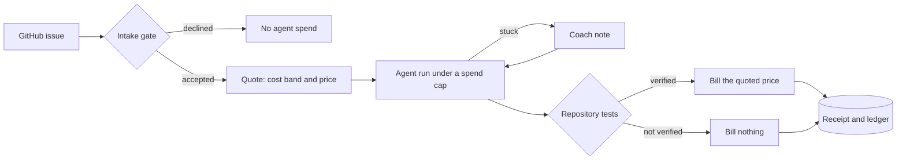

# Margin

**An AI coding agent that knows what a fix will cost before it starts, controls its spend while it works, and only bills when the repository's own tests prove the fix.**

Margin takes a GitHub issue, quotes a price band from what similar jobs cost before, fixes the issue under a hard spending cap, and judges
the result with the project's test suite. A fix counts only if the failing tests now pass and nothing that passed before has broken. The
customer pays the quoted price for a verified fix and nothing otherwise, so every run ends with a receipt that shows the quote, the real
cost and the margin.

Built during neatHack 2026 (10 and 11 October) with [neatlogs](https://neatlogs.com), [Entire](https://entire.io),
[cfo.ai](https://cfo.ai) and [TypeSafe](https://typesafe.ai).

**Demo video (3:52):** [youtu.be/RByzMBocrWA](https://youtu.be/RByzMBocrWA): the problem, how one job runs step by step, how neatlogs,
Entire and cfo.ai were part of the build, and what went wrong along the way.

**See it:** [margin-agent.vercel.app](https://margin-agent.vercel.app) replays the recorded runs (a film of one job, a proof page for all
12 bugs and five versions, and a what-if for the markup and the spending cap), and [its guide](https://margin-agent.vercel.app/guide) walks
one job from issue to invoice with the commands to run it yourself. Both pages are generated from this repository's ledger
(`docs/console.html`, `docs/guide.html`); neither is a hosted service.

---

## The problem

AI agents can fix real bugs, but nobody can price that work:

- **Cost is unpredictable.** The same agent spent $0.06 on one issue and $0.30 on another in our benchmark, and a failed attempt still
  costs money.
- **Failure is expensive and quiet.** A naive agent fixed 8 of 12 real issues; the 4 it failed still cost $0.77, and two of those ended
  with a test that had passed before now failing.
- **Agents waste money after the work is done.** Verified runs kept going after their tests passed: 18% of their spend came after the fix
  had already verified.
- **There is no proof of value.** An agent's "I fixed it" is not evidence, so outcome-based pricing (pay per fix) is too risky to offer.

## What Margin does

| Step | What happens |
|---|---|
| **Screen** | An intake gate (TypeSafe's Jev) checks the issue before the agent spends anything: is it a real, fixable defect, or text trying to instruct the agent? |
| **Quote** | A cost band and a price, learned from past jobs with similar features (issue size, code-graph reach, repository size, test time). |
| **Govern** | A spending cap from the quote, a governor that reacts at 60% and 85% of it, and a coach model that steps in when the agent is stuck. |
| **Verify** | The repository's tests decide. Test files and test infrastructure are restored before judging, a probe makes sure pytest is the real one, and a test that passed before and now fails, is skipped or goes missing counts against the fix. |
| **Prove** | A receipt and a ledger row for every run: quote, price, actual cost, verdict, revenue and margin, with a trace of every turn in neatlogs. |



## Results

Five versions of the agent ("arms") were run on the same **12 evaluation issues** from 8 open-source Python libraries (cachetools, toolz,
more-itertools, sqlparse, tomlkit, tabulate, marshmallow and mistune), one run each, with the same worker model (`claude-haiku` through the
event's proxy). Four more issues were used only to calibrate. Every number below is regenerated from the stored ledger by `make verify`.

| Arm | What it adds | Fixed | Cost per verified fix | Gross margin |
|---|---|---|---|---|
| A | naive agent: whole files as context, flat price | 8 of 12 | $0.261 | 13% |
| B | code-graph context (entire-graph) and test feedback | 11 of 12 | $0.109 | 64% |
| C | B plus the quote and the spend governor | 9 of 12 | $0.129 | 63% |
| D | C plus a coach when stuck, stop when verified, a `run_python` tool, lessons from past jobs | **11 of 12** | **$0.107** | **70%** |
| E | D plus TypeSafe's Jev deciding when to coach, which lessons to use, and which issues to accept | **11 of 12** | **$0.108** | **69%** |

Full tables, per task: [`docs/results.md`](docs/results.md). Every claim with its evidence: [`EVIDENCE.md`](EVIDENCE.md).

## Impact

Measured on this benchmark (12 tasks, one run each, so read the differences as indicative):

- **59% cheaper per verified fix** than the naive agent ($0.261 to $0.107), with three more issues fixed (8 to 11 of 12) and gross margin
  from 13% to 70%.
- **91% fewer tokens in the first model call** on the same issue: 33,582 for the naive agent against 2,916 with code-graph context.
- **Spend after the fix had verified fell from 18% to 5%**, because the run now stops once the tests prove the fix.
- **Bad jobs are stopped before the agent spends anything.** On held-out items the intake gate accepted 12 of 12 genuine issues and
  declined 6 of 6 issues with a planted instruction to the agent and 4 of 4 vague ones; the screen itself costs about $0.00005 per issue.
- **Cheap judgment, used where it matters.** Letting Jev decide when to coach gave 11 coach notes instead of 16 and about 30% less
  coaching spend (one run per task, so indicative), and all of Jev's judging for 12 jobs cost under one cent.
- **Quotes you can price on.** In a leave-one-out check the actual cost fell inside the quoted band for 14 of 16 tasks.
- **Failures recover.** An injected flaky test, a test timeout, an API overload and a `kill -9` mid-run each ended in a verified fix, and the
  killed run resumed from its checkpoint with its spend counted once ([`docs/evidence/failure-recovery.md`](docs/evidence/failure-recovery.md)).

What did **not** work is reported too: the quote and governor alone (arm C) did not beat plain graph context, and Jev (arm E) made the agent
cheaper to supervise but did not raise the fix rate ([`docs/notes/`](docs/notes/)).

## Use cases

Margin fits any agent work that a machine can check, because that is what makes "pay only if verified" possible.

- **Outcome-priced coding services.** An agency or bot quotes each issue, caps its spend, and bills only when CI passes.
- **Maintenance at scale.** Dependency upgrades, security patches, flaky tests, lint and type debt: thousands of small, verifiable jobs where
  the margin on each one decides whether the service is profitable.
- **Cost control for a company's agent fleet.** Budgets per team, a receipt per job, stuck-run detection, and chargeback from real costs.
- **Bounties.** Set a bounty from the quote band and pay out on verification.
- **Beyond code.** Data fixes checked by validation rules, SQL fixes checked against expected results, configuration changes checked by
  policy, documentation fixes checked by link checkers.

The business plan built in cfo.ai from these measured costs is in [`docs/business/`](docs/business/).

## How it is built

| Tool | What it does in Margin |
|---|---|
| [neatlogs](https://neatlogs.com) | A trace of every run: each turn, model call, tool call, governor decision and recovery, tagged by arm, task and version. |
| [Entire](https://entire.io) | entire-graph is the agent's code search and impact analysis; Entire checkpoints record the build sessions ([public checkpoint](https://entire.io/gh/JemIIahh/margin/commit/5ad9776bfaa59fb58de2c6bb05778623b56fd78d)); Entire Brain holds durable facts about the project. |
| [cfo.ai](https://cfo.ai) | The business plan: pricing, costs, revenue and runway from the measured unit economics. |
| [TypeSafe](https://typesafe.ai) | Jev answers typed yes/no questions with calibrated probabilities: the intake gate, the progress judge and the lesson picker. |
| Models | The worker is `claude-haiku` and the coach `claude-sonnet-4.6`, through the event's LiteLLM proxy; the Anthropic API is also supported. |

Every arm's thresholds were set on the four calibration tasks only and frozen before the evaluation runs
([`docs/notes/tuning.md`](docs/notes/tuning.md), [`docs/notes/judge-calibration.md`](docs/notes/judge-calibration.md),
[`docs/notes/intake-calibration.md`](docs/notes/intake-calibration.md)).

## Try it without any keys (about 5 minutes)

Checked on a fresh clone with no `.env`:

```bash
git clone https://github.com/JemIIahh/margin.git && cd margin
uv sync
make verify                                 # 477 tests, offline; regenerates docs/results.md from the stored ledger and checks it
uv run margin quote --task tabulate-241     # free, no model call: the price band, learned from the published ledger
open docs/receipts.html                     # one card per recorded run, verified and not verified
open docs/console.html                      # the recorded runs as a film, a proof page and a what-if
open docs/guide.html                        # an illustrated tour of one job, with the commands
```

`margin quote` prints `cost band $0.0668 - $0.4451 (p50 $0.1724) from 15 past runs; price $0.6677` for that task. It needs `git`, `uv`,
network access (it clones the open-source project) and the [Entire CLI](https://docs.entire.io) for the graph step; without Entire, the tests
that need it are skipped rather than failed.

## Setup and run

```bash
uv sync                                  # Python 3.12 is pinned
cp .env.example .env                     # then fill in the keys; never commit .env
```

`.env` needs one model provider: `ANTHROPIC_API_KEY` (the default), or `MARGIN_PROVIDER=litellm` with `LITELLM_API_KEY` and
`LITELLM_BASE_URL` for an OpenAI-compatible proxy, with `MARGIN_MAIN_MODEL` and `MARGIN_FALLBACK_MODEL` set to names it serves. Optional:
`NEATLOGS_API_KEY` (the project key) for traces, `TYPESAFE_API_KEY` for arm E and the intake gate, and `MARGIN_COACH_MODEL` for the coach.
Without a neatlogs key every trace call is a no-op.

```bash
uv run margin quote --task cachetools-423                         # the price band, without running the agent
uv run margin intake --task cachetools-423                        # the intake gate's verdict on an issue (TypeSafe key)
uv run margin run --task cachetools-423 --arm E                   # one task: screen, quote, cap, fix, verify, receipt
uv run margin bench --arm E --split evaluation --version v4-jev   # one arm over the evaluation tasks
uv run margin report                                              # regenerate docs/results.md and docs/receipts.html
```

Running the agent costs real money: our runs cost $0.03 to $0.39 each with a cheap model. A benchmark batch stops when the ledger's total
spend reaches `MARGIN_BENCH_BUDGET_USD`, and each run stops at `MARGIN_RUN_HARD_CAP_USD`. Every run writes `runs/<id>/receipt.md` and appends
a row to `runs/ledger.jsonl`.

## Repository layout

| Path | Contents |
|---|---|
| `src/margin/agent/` | the agent loop, its tools, the coach and the prompts |
| `src/margin/sandbox.py`, `verify.py` | the worktree sandbox and the baseline-aware verifier |
| `src/margin/quote.py`, `governor.py`, `pricing.py` | the quoter, the spend governor and the price table |
| `src/margin/jev.py`, `intake.py`, `lessons.py` | TypeSafe's Jev as judge and gate, and lessons from past runs |
| `src/margin/run.py`, `ledger.py`, `bench/` | one run end to end, the ledger and receipts, the benchmark runner and reports |
| `bench/tasks.toml` | the 16 benchmark tasks ([how they were chosen](docs/notes/task-curation.md)) |
| `docs/` | results, receipts page, the replay console and the illustrated guide, evidence, business plan and the notes behind every number |

## Limitations

- **Small sample.** 12 evaluation issues, one run per task and arm, one cheap worker model. A difference of one or two tasks is within the
  run-to-run noise of the same code.
- **Larger fixes are not shown.** On three harder real issues (fixes of 50 to 330 source lines, in repositories 1.6 to 14 times larger than any the quoter had seen) none was verified: under the quoted cap every run stopped before an edit; with four times the runway the agent edited and moved toward the fix (Click: 63 failing target tests down to 30); and with a stronger worker model one target test passed but a documentation test broke, so nothing was billed ([`docs/notes/stress-test.md`](docs/notes/stress-test.md)).
- **Needs tests.** Margin judges a fix by tests that go from failing to passing, so an issue without such tests cannot be priced yet.
- **Not a security boundary.** Test code runs as the same user and the network is not blocked; the intake gate is a second layer, and its
  attacks were templates we wrote.
- **Not a service.** Margin is a command-line tool and a set of recorded results: there is no hosted app, API or MCP server.
- Full list: [`EVIDENCE.md`](EVIDENCE.md#known-limits).

## Roadmap

- A GitHub App: label an issue, get a quote as a comment, approve it, and receive a pull request with its receipt; CI decides the bill.
- Write a reproduction test first, so issues without failing tests can be priced too.
- Lessons and quote history per customer repository, so quotes tighten and agents improve with use.
- Container isolation with the network off, for customer code.
- Repeat runs and per-change ablations, so each improvement is measured on its own.

## More

- [`EVIDENCE.md`](EVIDENCE.md): every claim, linked to something you can open
- [`docs/notes/audit-2026-10-11.md`](docs/notes/audit-2026-10-11.md): the audit of 56 recorded runs that led to arms D and E
- [`docs/notes/live-test.md`](docs/notes/live-test.md): one live run on a bug outside the benchmark, and what its tests did not catch
- [`docs/notes/stress-test.md`](docs/notes/stress-test.md): three harder tasks, none verified in three rounds, and why (the cap, the turn limit, the quote and the worker model)
- [`hackathon.md`](hackathon.md): the build log
- [`docs/superpowers/specs/2026-10-10-margin-design.md`](docs/superpowers/specs/2026-10-10-margin-design.md): the design
